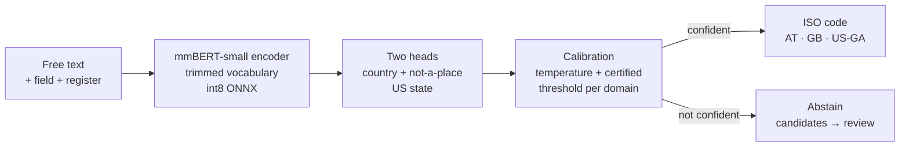

<div align="center">

# CountryCode-Decide

### Messy country names → ISO 3166 codes, with a calibrated "I don't know"

A small open model that reads a country or US state the way registers and forms write it —<br>
any language or script, misspelled, abbreviated, historical — on your own machine:<br>
75 MB, about 4 ms per string on a CPU.

[](LICENSE)
[](pyproject.toml)
[](https://huggingface.co/aildan/country-code-decide-small)

[Quick start](#quick-start) · [At a glance](#at-a-glance) · [Accuracy](#accuracy) ·
[How it works](#how-it-works) · [Limitations](#limitations-and-responsible-use) ·
[Model card](model_card.md)

</div>

---

Company registers, onboarding forms and scanned documents write countries as free text:
`Østerrike`, `Deleware`, `England and Whales`, `BRITHISH VIRGIN ISLANDS`, `10250 THAILAND`, `n/a`.
Downstream systems need ISO codes. Rule libraries miss most foreign-language and misspelled
forms, a name lexicon with fuzzy matching makes confident false hits (`n/a` → `NA`, Namibia), and
general-purpose language models are slow and give no usable signal of when they are unsure.

CountryCode-Decide returns a typed answer, never free text — an ISO 3166-1 alpha-2 country code
(250 codes: the 249 ISO codes + `XK` Kosovo), an ISO 3166-2:US state code (`US-CA`, … 50 states +
`US-DC`) when the place is in the US, or "not a country" — with a calibrated probability. When it
cannot meet the error rate you ask for, it **abstains** and sends the string to a person, with a
short candidate list:

| Input | Context | Answer at the 2 % error target | Confidence |
|---|---|---|---|
| `Østerrike` | country field, NO register | **AT** Austria | 0.99 |
| `Untted Klngdom` | country field | **GB** United Kingdom | 0.95 |
| `England and Whales` | country field, GB register | **GB** United Kingdom | 0.96 |
| `BRITHISH VIRGIN ISLANDS` | country field | **VG** British Virgin Islands | 0.98 |
| `10250 THAILAND` | country field | **TH** Thailand | 1.00 |
| `Nederländerna` | country field, SE register | **NL** Netherlands | 0.99 |
| `中华人民共和国` | country field | **CN** China | 0.88 |
| `W. Germany` | country field | **DE** Germany | 1.00 |
| `Calif` | jurisdiction field, US register | **US-CA** California | 0.97 |
| `Georgia` | jurisdiction field, US register | **US-GA** Georgia | 0.93 |
| `Georgia` | none | abstains → review (candidates GE, US-GA) | 0.75 |
| `Europe` | country field | **NONE** not a country or US state | 1.00 |
| `n/a` | country field | abstains → review (candidates NE, NONE, ZA) | 0.12 |
| `Deutchland` | country field | abstains → review (candidates DE, US-SD) | 0.47 |
| `Czechoslovakia` | country field | abstains → review (candidates CZ, SK) | 0.50 |

The examples were chosen by hand to show the behaviour; the answers are the release model's real
output ([`results/`](results/), generated by `scripts/run_examples.py`). Accuracy is measured below.

## At a glance

| Fresh registers, 361 distinct strings, read once | CountryCode-Decide small v1.2 |
|---|---|
| Accuracy, every string answered | 88.6 % (95 % CI 85.3–91.7) |
| Right country (a US state counts as US) | 91.2 % |
| At the certified 2 % error target | answers 86 % automatically, realised error 1.0 % |
| Best non-LLM baseline (multilingual-e5 nearest name) | 82.5 % |
| Zero-shot LLM (qwen3.5_35b-a3b-q4_K_M) | 85.0 %, ~29× slower (LLM on a GPU, this model on a CPU) |
| Model file · CPU latency | 75 MB (int8 ONNX) · p50 4.1 ms per string |

All numbers in this README are generated from [`results/`](results/) by `scripts/make_docs.py`.
The fresh test is every distinct value of the jurisdiction and country fields of two business
registers — New York and Oregon — that were never used for training, calibration or model
selection, labelled by an exact lexicon match or by a human reviewer, and read once after a frozen
pre-registration. Most of those strings are standard names; strings with no exact lexicon match
are much harder (see [Accuracy](#accuracy)).

## Why CountryCode-Decide

| | |
|---|---|
| **Codes, not text** | Every answer is a probability over a fixed label space: 250 country codes, 51 US state codes and "not a country". Nothing is generated, so it cannot invent a code that does not exist. It can still be wrong with high confidence, which is why a person reviews abstentions and candidate lists. |
| **Says "I don't know" — with a certificate** | Thresholds are chosen by a fixed-sequence test (Learn-then-Test) on held-out real register strings, so "answer only above λ" carries a finite-sample guarantee on the error rate (certified targets — curated: 5 %; register: 2 %, 5 %). Below the threshold the string goes to review. |
| **Reads context** | `CA` in a US *jurisdiction-of-formation* field is California, in a *country* field Canada; `Georgia` is the US state for a US register and the country otherwise. The request carries the field and the register's country. |
| **Any language, script and typo** | Trained on country names from Unicode CLDR and Wikidata in many languages and scripts (see the lexicon under How it works), GeoNames places, real register strings, and generated variants (keyboard typos on real layouts, transliterations, formatting noise) that passed quality gates and a human audit. |
| **Small and fast** | One 8-bit ONNX file; serving needs no PyTorch and no GPU — onnxruntime, tokenizers and NumPy do the work, offline. It also runs in the browser (onnxruntime-web). |
| **Open and measured honestly** | Apache-2.0 code and weights. Pre-registered hypotheses, a test set read once, baselines including a 35B LLM, and every number generated from `results/`. |

## How it works



1. **Lexicon** — 372,683 names in 1,274 languages (CLDR 47, Wikidata, codes, reviewed overrides); 86,406 distinct keys, 1,947 kept as genuinely ambiguous. Ambiguity is explicit: a key maps to a *set* of codes.
2. **Training strings** — the lexicon, register strings of the training split labelled by a person
   or by the register's own code, and generated variants: keyboard typos on real layouts (fitted to
   real typo statistics), transliterations, formatting variants, place context (GeoNames cities
   and regions with the country name), two-country strings, compass and region qualifiers,
   Canadian province codes in US jurisdiction fields, and non-place strings (placeholders,
   generated company names, legal terms, dates, street lines). Every generator release the model
   uses passed quality gates — collision checks against all names, realism against real typos, no overlap with
   evaluation strings, reproducibility, measured usefulness on held-out real strings — and a human
   audit of its labels ([model card](model_card.md)).
3. **Model** — `jhu-clsp/mmBERT-small` fine-tuned with two heads (country + not-a-place, US
   state), the field context as a first segment; its vocabulary trimmed to the tokens of the
   training texts, exported to ONNX with 8-bit weights (an int8 embedding table and 8-bit
   `MatMulNBits` matrix products, which the CPU runtime computes with int8 activations).
4. **Calibration** — per-domain temperatures and thresholds chosen by fixed-sequence testing:
   temperatures and the order of candidate thresholds are fitted on one set of held-out real
   strings, and the error-rate certificate is computed on another. Candidate lists hold every code
   with calibrated probability ≥ 0.05 (at most three); they are suggestions, not certified.

## Quick start

**1. Install.** You need [uv](https://docs.astral.sh/uv/) and Python 3.12. Serving needs no
PyTorch and no GPU.

```bash
git clone https://github.com/aliildan/country-code-decide
cd country-code-decide
uv sync --no-default-groups --group serve
source .venv/bin/activate        # plain `uv run` would sync the full training stack (PyTorch)
```

**2. Download the model** (int8 ONNX, tokenizer, calibration):

```bash
uvx --from huggingface_hub hf download aildan/country-code-decide-small \
  --local-dir models/country-code-decide-small
```

**3. Code strings in Python.**

```python
from countrycode.infer.pipeline import CountryCoder

coder = CountryCoder.load("models/country-code-decide-small")
reg = dict(domain="register", alpha=0.02)   # register calibration, 2 % error target

coder.code("Østerrike", field="country", **reg).target                          # 'AT'
coder.code("Georgia", field="jurisdiction", register_country="US", **reg).target  # 'US-GA'
d = coder.code("Georgia", **reg)            # no context: abstains
d.abstain, d.candidates                     # (True, ('GE', 'US-GA'))
coder.code("Deleware", field="jurisdiction", register_country="US",
           domain="register", alpha=None).target                                # always answer: 'US-DE'
```

`field` is `country`, `jurisdiction`, `nationality` or `unknown`; `register_country` is the
ISO code of the register (or `US-XX` for a US state register). `alpha` is the error-rate target
(`None` always answers); `domain` picks the calibration — `"register"` for register and form
fields, `"curated"` for curated name lists; without it the stricter of the two applies.
`code_batch` takes lists.

**4. Or run the server.**

```bash
python server/app.py --bundle models/country-code-decide-small
curl -s localhost:8320/v1/countrycode -H 'content-type: application/json' -d '{
  "items": [{"text": "Untted Klngdom", "field": "country", "domain": "register"},
            {"text": "CA", "field": "jurisdiction", "register_country": "US", "domain": "register"}],
  "alpha": 0.02}'
```

`POST /v1/countrycode` codes a batch; `POST /v1/systemone` answers the typed questions `country`,
`us_state` and `is_country` in the System One schema (probabilities + `abstain`).

**In the browser.** `web/` is a static demo that runs the same model file with onnxruntime-web,
without a server: copy the downloaded files into `web/model/` and serve the folder
(`python -m http.server -d web`). onnxruntime-web computes the 8-bit matrix products in fp32 where the CPU server uses int8, so probabilities differ slightly: on 3,570 held-out strings the browser makes the same decision as the server for 99.9 % at the 2 % target (same top code 98.9 %; top probability off by 0.005 on average, at most 0.08). The certificate applies to the server and Python path.

## Accuracy

- Country-level accuracy (right country; a US state counts as US): 0.912 (highest: v1_model 0.921).
- On the 33 strings not in the lexicon (no exact name match) the model's accuracy is 0.212.
- At the certified 2 % error target the model answers 86% of the strings automatically with a realised error of 1.0 %; non-places get a code 0.0 % of the time (n = 4). The 2 % certificate (fixed-sequence test on the register calibration strings) is not contradicted on the fresh registers. The 1 % target could not be certified.
- The zero-shot LLM (qwen3.5_35b-a3b-q4_K_M) is less accurate when every string must be answered (0.850 vs the model's 0.886); its own confidence covers 71% of the strings at 5 % empirical risk, without a certificate. It is ~29× slower (the LLM on a GPU, this model on a CPU).


<details>
<summary><b>All predictors on the fresh test</b> (New York + Oregon, distinct strings)</summary>

| predictor | n | acc | acc (freq-weighted) | country acc | coverage @1 % risk | coverage @5 % risk | non-place false accept | ECE | ms / item |
|---|---|---|---|---|---|---|---|---|---|
| model | 361 | 0.886 | 1.000 | 0.912 | 0.856 | 0.911 | 0.750 | 0.058 | 4.2 |
| v1_model | 361 | 0.884 | 1.000 | 0.921 | 0.197 | 0.864 | 1.000 | 0.253 | 3.7 |
| model@0.05 | 361 | 0.873 | 1.000 | 0.881 | 0.856 | 0.903 | 0.000 | 0.041 | 4.1 |
| model@0.02 | 361 | 0.856 | 1.000 | 0.864 | 0.856 | 0.856 | 0.000 | 0.032 | 4.1 |
| llm_qwen3.5_35b-a3b-q4_K_M | 361 | 0.850 | 0.997 | 0.858 | 0.000 | 0.709 | 0.000 | 0.108 | 116.9 |
| e5_knn | 361 | 0.825 | 0.995 | 0.847 | 0.091 | 0.825 | 0.750 | 0.108 | 0.6 |
| lexicon_fuzzy | 361 | 0.795 | 0.994 | 0.802 | 0.000 | 0.820 | 0.500 | 0.054 | 0.9 |
| lexicon_exact | 361 | 0.789 | 0.994 | 0.793 | 0.000 | 0.787 | 0.250 | 0.014 | 0.0 |
| ons_style | 361 | 0.787 | 0.994 | 0.793 | 0.000 | 0.792 | 0.500 | 0.044 | 0.3 |
| countrynames | 361 | 0.634 | 0.761 | 0.745 | 0.000 | 0.000 | 0.000 | 0.226 | 2.5 |
| pycountry | 361 | 0.634 | 0.761 | 0.776 | 0.000 | 0.000 | 0.250 | 0.184 | 1.4 |
| coco | 361 | 0.596 | 0.761 | 0.601 | 0.000 | 0.000 | 0.250 | 0.120 | 0.5 |
| model@0.01 | 361 | 0.011 | 0.000 | 0.000 | 0.000 | 0.000 | 0.000 | – | 4.1 |

`acc` counts an abstention as wrong, except for "not a country" strings and ambiguous strings
(abstaining with exactly the gold set is right); `coverage @ x % risk` is the largest share
answered, most confident first, whose error on these test labels stays ≤ x % (an oracle
threshold, no certificate); `model@0.02` is the release model at its certified 2 % target. Baselines: exact lexicon, lexicon + RapidFuzz,
an ONS-style index with Levenshtein distance, an untrained multilingual-e5 nearest-neighbour
lookup, OpenSanctions `countrynames`, `pycountry`, `country_converter` (`coco`), and a 35B
open LLM zero-shot (Qwen3.5-35B-A3B, 4-bit, on a GPU). `v1_model` is the previous release.

</details>

<details>
<summary><b>Other evaluation sets</b> (read before this release; reported, not evidence)</summary>

Register strings held out from the training registers (Colorado, Connecticut, UK Companies
House, Brønnøysund; read once for v1.1):

| predictor | n | acc | acc (freq-weighted) | country acc | coverage @1 % risk | coverage @5 % risk | non-place false accept | ECE | ms / item |
|---|---|---|---|---|---|---|---|---|---|
| model | 656 | 0.826 | 0.999 | 0.899 | 0.220 | 0.785 | 0.318 | 0.032 | 5.9 |
| model@0.05 | 656 | 0.820 | 0.999 | 0.829 | 0.220 | 0.785 | 0.061 | 0.023 | 5.8 |
| model@0.02 | 656 | 0.768 | 0.998 | 0.755 | 0.220 | 0.713 | 0.015 | 0.014 | 5.9 |
| v1_model | 656 | 0.767 | 0.999 | 0.902 | 0.027 | 0.495 | 0.803 | 0.092 | 5.5 |
| llm_qwen3.5_35b-a3b-q4_K_M | 656 | 0.738 | 0.849 | 0.734 | 0.000 | 0.000 | 0.000 | 0.197 | cached |
| e5_knn | 656 | 0.625 | 0.637 | 0.741 | 0.091 | 0.175 | 0.939 | 0.241 | 0.4 |
| lexicon_fuzzy | 656 | 0.559 | 0.561 | 0.575 | 0.000 | 0.000 | 0.394 | 0.223 | 9.0 |
| ons_style | 656 | 0.390 | 0.560 | 0.350 | 0.000 | 0.000 | 0.242 | 0.125 | 2.2 |
| coco | 656 | 0.338 | 0.031 | 0.276 | 0.000 | 0.000 | 0.000 | 0.330 | 0.2 |
| countrynames | 656 | 0.276 | 0.031 | 0.259 | 0.000 | 0.000 | 0.000 | 0.364 | 16.8 |
| lexicon_exact | 656 | 0.241 | 0.560 | 0.140 | 0.122 | 0.122 | 0.000 | 0.000 | 0.0 |
| pycountry | 656 | 0.236 | 0.031 | 0.194 | 0.000 | 0.000 | 0.197 | 0.357 | 2.9 |
| model@0.01 | 656 | 0.116 | 0.000 | 0.000 | 0.000 | 0.000 | 0.000 | – | 5.9 |

GBIF's curated country-name list (a harder, different population: many historical and
descriptive names), where the zero-shot LLM is more accurate than this model:

| predictor | n | acc | acc (freq-weighted) | country acc | coverage @1 % risk | coverage @5 % risk | non-place false accept | ECE | ms / item |
|---|---|---|---|---|---|---|---|---|---|
| llm_qwen3.5_35b-a3b-q4_K_M | 3980 | 0.696 | 0.696 | 0.669 | 0.000 | 0.000 | 0.195 | 0.205 | cached |
| v1_model | 3980 | 0.591 | 0.591 | 0.700 | 0.031 | 0.294 | 0.833 | 0.047 | 4.9 |
| model | 3980 | 0.589 | 0.589 | 0.688 | 0.033 | 0.359 | 0.796 | 0.083 | 4.9 |
| coco | 3980 | 0.576 | 0.576 | 0.510 | 0.000 | 0.000 | 0.165 | 0.118 | 0.2 |
| lexicon_fuzzy | 3980 | 0.564 | 0.564 | 0.616 | 0.000 | 0.196 | 0.638 | 0.346 | 8.9 |
| e5_knn | 3980 | 0.548 | 0.548 | 0.651 | 0.011 | 0.076 | 0.849 | 0.355 | 0.2 |
| model@0.05 | 3980 | 0.499 | 0.499 | 0.384 | 0.033 | 0.333 | 0.051 | 0.080 | 4.9 |
| ons_style | 3980 | 0.492 | 0.492 | 0.427 | 0.000 | 0.232 | 0.253 | 0.172 | 2.5 |
| countrynames | 3980 | 0.394 | 0.394 | 0.244 | 0.000 | 0.200 | 0.019 | 0.151 | 20.2 |
| lexicon_exact | 3980 | 0.368 | 0.368 | 0.211 | 0.000 | 0.177 | 0.020 | 0.024 | 0.0 |
| pycountry | 3980 | 0.301 | 0.301 | 0.141 | 0.062 | 0.062 | 0.070 | 0.090 | 3.5 |
| model@0.01 | 3980 | 0.204 | 0.204 | 0.000 | 0.000 | 0.000 | 0.000 | – | 5.0 |
| model@0.02 | 3980 | 0.204 | 0.204 | 0.000 | 0.000 | 0.000 | 0.000 | – | 4.9 |

</details>

Pre-registered hypotheses for this release, written down and frozen before the test was read:

| hypothesis | result | evidence |
|---|---|---|
| P1 | met | certified=True, lambda=0.827, answered_n=309, errors=3, p_value_risk_le_2pct=0.947, contradicted=False |
| P2 | met | answered=0.856 |
| P3 | met | size_mb=74.732, cpu_p50_ms=4.092, tokens_identical=1.000, select_accuracy_drop=0.003 |
| P4 | met | model_accuracy=0.886, best_non_llm=e5_knn, best_non_llm_accuracy=0.825 |
| A1 | reported (not judged) | certified=False, answered=0.000, risk_answered=nan |

Gold labels: The register calibration strings were labelled a second time, blind (no proposal and no first label shown): agreement 99.2 % on 592 strings (5 disagreements); one-sided 95 % upper bound on disagreement 1.8 %.

## Labels

| Output | Values |
|---|---|
| `country` | ISO 3166-1 alpha-2: the 249 officially assigned codes + `XK` (Kosovo, user-assigned). Reserved codes written as text map to their country (`UK` → `GB`, `EL` → `GR`). |
| `us_state` | ISO 3166-2:US for the 50 states + `US-DC`, only when the country is `US`. Puerto Rico, Guam, the US Virgin Islands, American Samoa, the Northern Mariana Islands and the Minor Outlying Islands are answered as countries (`PR`, `GU`, …), as in GLEIF, SWIFT and ISO 20022. |
| not a country | `NONE`: placeholders (`n/a`, `unknown`), continents and regions (`Europe`), company names, dates, street lines. |
| ambiguous | Names that denote several codes (`Georgia` without context, `Congo`, `Yugoslavia`, `Czechoslovakia`) are labelled as sets; the model should abstain or give candidates. |

## Data and licences

Model and code: Apache-2.0. Names: Unicode CLDR (Unicode License v3), Wikidata (CC0), GeoNames
(CC BY 4.0). Register strings: Colorado, Connecticut and Oregon open data (public domain), UK
Companies House (OGL v3), Brønnøysund Register Centre (NLOD); New York open data (OPEN-NY terms)
is used for evaluation only. GBIF's country-name parser list (Apache-2.0) is a second, curated
evaluation domain. Copyleft or non-commercial resources (pycountry, country_converter,
OpenSanctions data) run only as evaluation baselines and are not part of the model or the server.

No dataset is redistributed, and no personal data is used: register sources were read with
aggregate queries (distinct value and count), never records. The scripts re-fetch everything from
the official sources.

Training data of the released model:

| generator | training examples | human audit (errors / audited) |
|---|---|---|
| junk@2 | 1,375 | 0 / 300 |
| keyboard@2 | 9,812 | 0 / 300 |
| format@4 | 13,411 | 0 / 300 |
| translit@4 | 4,396 | 0 / 300 |
| geo@2 | 7,381 | 0 / 300 |
| pairs@3 | 3,988 | 0 / 300 |
| affix@2 | 785 | 0 / 300 |
| caprov@1 | 78 | 0 / 39 |
| regjunk@1 | 2,731 | 0 / 300 |

- 142,925 training examples: 98,517 lexicon names and codes (68.9 %), 43,957 generated (30.8 %), 451 real register strings (0.3 %).
- Real register strings are labelled by a person or by the register's own code; none shares a normalised key with any evaluation part.

Serving: p50 4.1 ms, p95 5.1 ms per string on CPU (4 threads, ONNX Runtime, tokenisation included); model file 75 MB.

## Limitations and responsible use

- **Gold labels** of the register strings come from one human reviewer; the calibration strings
  were labelled a second time by the same reviewer, blind — this measures consistency, not
  agreement between people.
- **Standard names dominate the fresh test.** Strings with no exact lexicon match are much harder
  (see Accuracy), and the certified thresholds leave many of them unanswered.
- **Known gaps:** Canadian province codes in US jurisdiction fields (`ON`, `BC`) were never in
  training (every such string is an evaluation string) and are not recognised; `Congo` without
  context is answered as `CG` although it may mean either Congo.
- **Certificates are population-specific.** Thresholds certified on register strings do not
  transfer automatically to another source — recalibrate on your data. The curated GBIF domain is
  much harder than registers for this model, and the 1 % target could not be certified.
- **One field at a time.** Full postal addresses and subdivisions other than US states are out of
  scope.
- **Keep a person in the loop.** Not legal advice; abstentions and candidate lists need human
  review, and no decision about a person should rest on this model alone.

## Reproduce

The whole pipeline runs on one machine; training used one RTX 5090.

```bash
uv sync                                   # full stack incl. PyTorch (cu128 wheels on Linux)
make lexicon real synth                   # official sources → lexicon, real strings, generator releases + gates
uv run python -m countrycode.train fit --config configs/train/small-v12f.yaml
uv run python -m countrycode.infer trim --run runs/small-v12f --out runs/r-trim-C --synth-texts --no-single-chars
uv run python -m countrycode.infer bundle --run runs/r-trim-C --out dist/countrycode-small-v1.2 --version v1.2
scripts/final_run_v12.sh small-v1.2 small-v12f    # G1 stamp, calibration, latency, evaluation
uv run python scripts/make_docs.py        # README.md and model_card.md from results/
```

What is not in this repository: the human gold labels of the evaluation strings and the human
audit verdicts of the generated data (aggregate results only, in [`results/`](results/)).
Without them, training reproduces, but calibration and evaluation need your own labelled strings.
`make synth` also builds generators the released model does not use (OCR, LLM paraphrases),
which need a local OCR engine and cached hosted-LLM outputs.

## Citation

```bibtex
@software{ildan2026countrycode_software,
  title = {CountryCode-Decide: messy country names to ISO 3166 codes, with calibrated abstention},
  author = {Ildan, Ali},
  year = {2026},
  url = {https://github.com/aliildan/country-code-decide}
}
```

## Licence and attribution

Apache-2.0 ([LICENSE](LICENSE), [NOTICE](NOTICE)). Built on `jhu-clsp/mmBERT-small` (MIT), Unicode
CLDR, Wikidata and GeoNames. Personal, non-commercial, open-source project; not affiliated with
ISO or any register.
